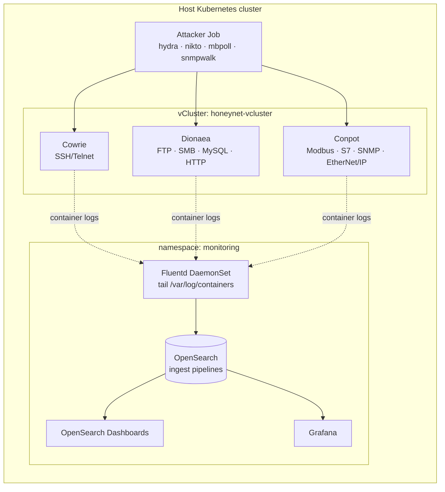

# Kubernetes Honeynet with Centralised Observability

A multi-protocol honeynet that runs inside an isolated **vCluster** on Kubernetes. A **Fluentd → OpenSearch** pipeline collects, parses and visualises every attacker interaction. A custom attacker image replays realistic multi-vector attacks (SSH/FTP/MySQL brute force, Modbus and SNMP probing, HTTP scanning) so the dashboards can be validated end to end.

## Architecture



| Component | What it does | Manifests |
|---|---|---|
| vCluster | isolates the honeypots from the host cluster's control plane | `vcluster-honeypot/vcluster-values.yaml`, `namespace.yaml` |
| Cowrie | SSH/Telnet honeypot (NodePort) | `vcluster-honeypot/cowrie-deployment.yaml` |
| Dionaea | FTP, SMB, RPC, MySQL, HTTP honeypot | `vcluster-honeypot/dionea-deployment.yaml` |
| Conpot | ICS/SCADA honeypot: Modbus, S7comm, SNMP, EtherNet/IP | `vcluster-honeypot/conpot-deployment.yaml` |
| Fluentd | DaemonSet with Kubernetes metadata enrichment, ships to OpenSearch | `fluentd-*.yaml` |
| OpenSearch + Dashboards | storage, search, dashboards | `opensearch*.yaml`, `Dashboards/`, `Panels/` |
| Ingest pipelines | parse Cowrie login attempts and Nikto scans into fields | `Pipelines/` |
| Grafana | alternative dashboards via the OpenSearch datasource | `grafana*.yaml` |
| Attacker | Debian image with hydra, nikto, mbpoll, snmpwalk | `Attacks/`, `multi-attack-job.yaml`, `hydra-job.yaml` |

## Quick start

Prerequisites: a Kubernetes cluster (Docker Desktop or kubeadm), `kubectl`, the [vCluster CLI](https://www.vcluster.com/docs/get-started), and Docker.

```bash
git clone https://github.com/OnsKoukiPro/Honeypot-CK8s.git
cd Honeypot-CK8s

# 1. monitoring stack
kubectl apply -f monitoring-ns.yaml
kubectl apply -f opensearch.yaml -f opensearch-service.yaml -f opensearch-dashboards.yaml
kubectl apply -f fluentd-rbac.yaml -f fluentd-configmap.yaml -f fluentd-daemonset.yaml
kubectl apply -f grafana.yaml -f grafana-datasource.yaml        # optional
kubectl get pods -n monitoring -w

# 2. honeynet inside a vCluster
vcluster create honeypot-cluster --namespace honeynet-vcluster -f vcluster-honeypot/vcluster-values.yaml
kubectl apply -f vcluster-honeypot/cowrie-deployment.yaml \
              -f vcluster-honeypot/conpot-deployment.yaml \
              -f vcluster-honeypot/dionea-deployment.yaml
vcluster disconnect                                             # back to the host context

# 3. generate attacks
docker build -t honeypot-attacker:latest Attacks/
kubectl create configmap attack-passwords --from-file=Attacks/passwords.txt
kubectl apply -f multi-attack-job.yaml                          # set TARGET_IP in the manifest
```

Then load the ingest pipelines from `Pipelines/` (OpenSearch Dev Tools) and import `Dashboards/Dashboard.json`.

```bash
kubectl port-forward svc/opensearch-dashboards -n monitoring 5601:5601   # http://localhost:5601
kubectl port-forward svc/opensearch -n monitoring 9200:9200              # curl localhost:9200/_cat/indices?v
```

## Troubleshooting

| Symptom | Fix |
|---|---|
| `opensearch-0` Pending | `kubectl describe pod/opensearch-0 -n monitoring`. Usually not enough memory: raise the Docker Desktop limits. |
| No logs in OpenSearch | `kubectl logs -n monitoring -l app=fluentd`. Reapply `fluentd-rbac.yaml`. |
| Grafana datasource error | check that the `grafana-opensearch-datasource` plugin version is 2.7.0 |

## Cleanup

```bash
vcluster delete honeypot-cluster --namespace honeynet-vcluster
kubectl delete -f . && kubectl delete ns monitoring
```

## Authors

Ons Kouki · Ahmed Houcine

> For research and education only. Run the attacker job only against infrastructure you own.
